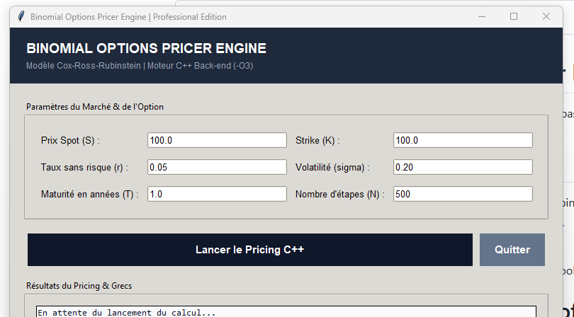

# Beezeweb - Binomial Options Pricer Engine

Moteur d'évaluation d'options financières (Européennes et Américaines) basé sur le modèle de l'arbre binomial de Cox-Ross-Rubinstein (CRR).

<p align="center">
  
</p>

## Fonctionnalités Clés
- Pricing haute précision (Calls / Puts) par rétropropagation sur arbre binomial.
- Exécution compilée ultra-rapide (C++ / C#) sans dépendance lourde.
- Sortie structurée prête pour l'audit quantitatif et l'automatisation.

Développé par Beezeweb (ionut-systems) - Quantitative & Automation Tools.
# Binomial Options Pricer Engine | Professional Edition

Un outil de pricing d'options quantitatif haute performance combinant un moteur de calcul **C++ (Modèle Cox-Ross-Rubinstein)** et une interface graphique **Python/Tkinter** moderne, avec des fonctionnalités d'export de rapports institutionnels (TXT/PDF).

---

## 🚀 Fonctionnalités Clés

- **Moteur C++ Haute Performance** : Implémentation rigoureuse du modèle binomial de Cox-Ross-Rubinstein (CRR) pour le pricing d'options européennes (Call & Put).
- **Interface Graphique Intuitive (Python / Tkinter)** : Saisie dynamique des paramètres de marché et de l'option en temps réel.
- **Multithreading** : Exécution asynchrone des calculs pour garantir une fluidité totale de l'interface utilisateur.
- **Rapports Institutionnels** : Génération instantanée de rapports de synthèse exportables en texte brut ou en PDF design grâce à *ReportLab*.
- **Portabilité Totale** : Application packagée sous forme d'exécutable autonome (via PyInstaller), ne nécessitant aucune installation de prérequis sur la machine cible.

---

## 🛠️ Architecture Technique

```text
Binomial_pricer/
├── src/
│   ├── app_ui.py           # Interface graphique Python & gestion des processus
│   └── Binomial_Engine.cpp # Moteur de calcul quantitatif C++ (optimisé -O3)
├── dist/                   # Package de distribution portable (Standalone .exe)
└── README.md